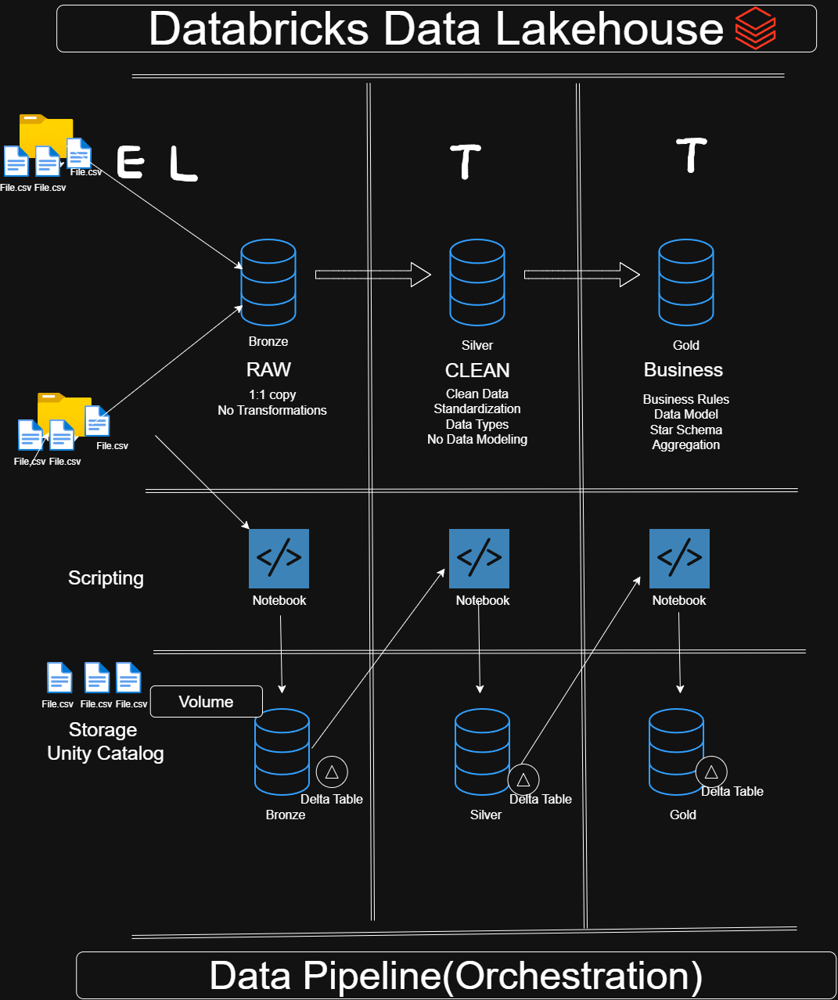

# Databricks Data Lakehouse Project

Welcome to the **Databricks Data Lakehouse Project** repo!

This project rebuilds my [SQL Server Data Warehouse Project](https://github.com/parthshahzyx/Data-Warehouse-Project) on **Databricks**. It uses the same CRM and ERP source data and the same business logic, but moves from a traditional on-premises data warehouse to a modern cloud lakehouse built on **Delta Lake** and **Unity Catalog**.

The goal was to see how the same end-to-end pipeline (raw CSV files → cleaned data → a business-ready star schema) changes when it moves from a legacy warehouse to a lakehouse platform.

---

## Data Architecture

The project follows the **Medallion Architecture** with **Bronze**, **Silver**, and **Gold** layers:



1. **Bronze Layer (Raw):** A 1:1 copy of the source CSV files, stored as Delta tables with no transformations. The files are uploaded to a Unity Catalog **Volume** and ingested from there.
2. **Silver Layer (Clean):** Data cleansing, standardization, and data type fixes. No data modeling happens in this layer.
3. **Gold Layer (Business):** Business-ready data modeled into a **star schema** (one fact table and two dimension tables) for reporting and analytics.

Each layer is built with notebooks, stored as Delta tables in Unity Catalog, and run in order by orchestration notebooks.

---

## Tech Stack

| Component | Used for |
|---|---|
| **Databricks** | Workspace, notebooks, and compute |
| **Unity Catalog** | Catalog, schemas (`bronze`, `silver`, `gold`), and the Volume holding raw files |
| **Delta Lake** | Storage format for every table in all three layers |
| **PySpark** | Bronze ingestion and orchestration |
| **Spark SQL** | All Silver and Gold transformations |
| **GitHub** | Version control through Databricks Git folders |

---

## SQL Server vs. Databricks: What Changed

| Area | SQL Server Data Warehouse | Databricks Data Lakehouse |
|---|---|---|
| Storage | SQL Server database tables | Delta tables governed by Unity Catalog |
| Raw file location | Local file path | Unity Catalog Volume (`/Volumes/workspace/bronze/raw_sources`) |
| Loading raw data | `BULK INSERT` inside a stored procedure | Config-driven PySpark loop that reads each CSV and writes a Delta table |
| Transformations | Stored procedures (`load_silver`) | One notebook per source table, written in Spark SQL |
| Gold layer | SQL views | Physical Delta tables |
| Orchestration | Run stored procedures manually | Orchestration notebooks that run each layer's notebooks in order (ready for Databricks Jobs) |

---

## Data Sources

Two source systems, each delivering three CSV files:

| Source | Files |
|---|---|
| **CRM** | `cust_info.csv`, `prd_info.csv`, `sales_details.csv` |
| **ERP** | `CUST_AZ12.csv`, `LOC_A101.csv`, `PX_CAT_G1V2.csv` |

The datasets are available in the [SQL Server project repo](https://github.com/parthshahzyx/Data-Warehouse-Project/tree/main/datasets).

---

## Silver Layer: Data Quality Rules

| Table | Cleaning applied |
|---|---|
| `crm_customers` | Trim text, map marital status (`S`/`M`) and gender (`F`/`M`) codes to full values, remove rows with no customer ID |
| `crm_products` | Split product key into `category_id` and `product_number`, replace missing cost with `0`, map product line codes (`M`, `R`, `S`, `T`) to names, cast start date to `DATE` |
| `crm_sales` | Convert `yyyyMMdd` integer dates to real dates (invalid values become `NULL`), recalculate missing or negative prices as sales ÷ quantity |
| `erp_customers` | Remove the `NAS` prefix from customer IDs, null out future birthdates, standardize gender values |
| `erp_customer_location` | Remove dashes from customer IDs, standardize country codes (`DE` → Germany, `US`/`USA` → United States, blank → `n/a`) |
| `erp_product_category` | Convert the maintenance flag from `Yes`/`No` to a boolean |

Every Silver table also gets clear, business-friendly column names (for example, `cst_firstname` → `first_name`).

---

## Gold Layer: Data Model (Star Schema)

| Table | Type | Description |
|---|---|---|
| `gold.dim_customers` | Dimension | Combines CRM customer data with ERP birthdate and country. Uses CRM gender first and falls back to ERP. Surrogate key: `customer_key` |
| `gold.dim_products` | Dimension | Combines CRM products with ERP category and subcategory details. Surrogate key: `product_key` |
| `gold.fact_sales` | Fact | Sales transactions linked to both dimensions through their surrogate keys |

---

## Repository Structure

```
lakehouse_2026/
├── architecture/
│   └── databricks_data_lakehouse.drawio.png   # High-level architecture diagram
└── scripts/
    ├── init_lakehouse.ipynb              # Creates the bronze, silver, and gold schemas and the raw-file Volume
    ├── bronze/
    │   └── bronze.ipynb                  # Ingests all 6 CSVs into Bronze Delta tables
    ├── silver/
    │   ├── silver_orchestration.ipynb    # Runs all Silver notebooks in order
    │   ├── crm/                          # Customer, product, and sales cleaning notebooks
    │   └── erp/                          # Customer, location, and product category cleaning notebooks
    └── gold/
        ├── gold_orchestration.ipynb      # Runs all Gold notebooks in order
        ├── gold_dim_customers.ipynb
        ├── gold_dim_products.ipynb
        └── gold_fact_sales.ipynb
```

---

## How to Run

1. **Set up:** Run `init_lakehouse` to create the schemas and the Volume.
2. **Upload data:** Upload the CSV files to `/Volumes/workspace/bronze/raw_sources/source_crm/` and `/source_erp/`.
3. **Bronze:** Run `bronze/bronze` to load the raw files into Delta tables.
4. **Silver:** Run `silver/silver_orchestration` to clean and standardize all six tables.
5. **Gold:** Run `gold/gold_orchestration` to build the star schema. It builds the dimension tables before the fact table.
